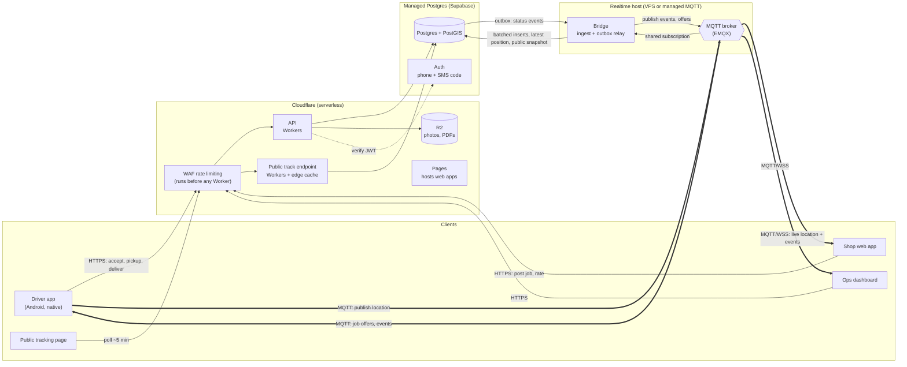
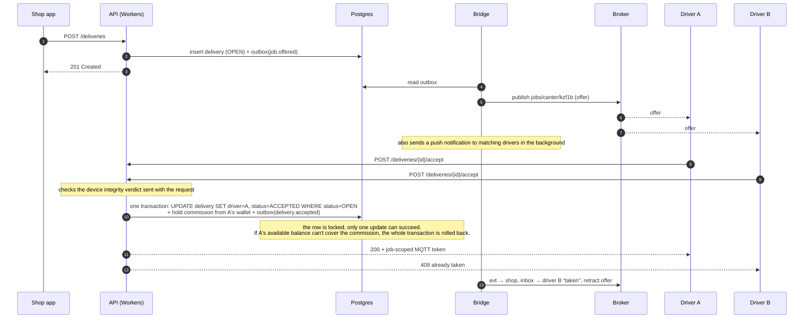
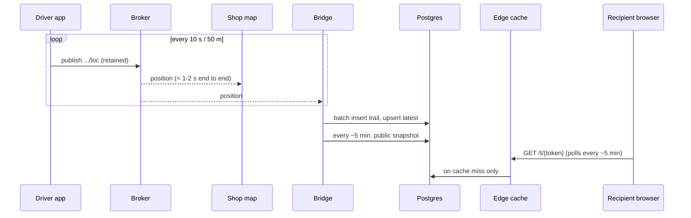

# Architecture

Status: proposal. Decisions still open are marked `Q-xx` (see [OPEN_QUESTIONS.md](OPEN_QUESTIONS.md)).

---

## 1. The one idea that shapes everything: two planes

The system moves two very different kinds of data, and treating them the same is the most common
mistake in apps like this.

| | **Control plane** | **Location plane** |
|---|---|---|
| What | Jobs, accepts, pickups, deliveries, payments, ratings, documents | GPS positions of drivers |
| Volume | Low (a few writes per delivery) | High (a point every few seconds per active driver) |
| Must be | **Correct.** Exactly one driver wins a job. A delivery code is checked once. Money adds up. | **Fresh.** The latest point matters most; losing one point is fine |
| Shape | Request → response, transactions | Fire-and-forget stream, fan-out to watchers |
| Transport | HTTPS API | **MQTT** (publish / subscribe) |
| Source of truth | Postgres | The stream itself; Postgres keeps history |

So: **state changes go through the API and the database; positions flow through a message broker.**
The two planes meet in exactly one place, a small service called the **bridge**.

## 2. Is MQTT a good fit? Yes, with three adjustments

MQTT was designed for many small devices on unreliable networks sending small, frequent messages.
That describes a fleet of drivers on Tanzanian mobile data. It gives us:

- Tiny packets (a few bytes of protocol overhead), which matters for drivers' data bundles.
- **Automatic reconnect and session resume** in mature client libraries.
- **Retained messages**: the broker remembers the last position on a topic, so a shop opening the
  map sees the driver *immediately*, not after the next update.
- **Last Will**: when a driver's phone drops off, the broker itself announces "driver offline".
- **Topic-level permissions**: a shop can be allowed to read only its own deliveries.
- **Shared subscriptions**: several copies of the bridge can split the load with no extra code.
- Fan-out for free: one driver publish, many watchers (shop staff on two laptops, ops dashboard,
  the bridge) with no extra work on the phone.

Your proposed flow was: driver publishes → worker subscribes and writes to DB → frontend reads DB,
and ideally the frontend subscribes directly. Here is that design, refined:

1. **The shop's live map subscribes to the broker directly** (MQTT over secure WebSockets). No
   backend hop, no database in the live path. Latency is just phone → broker → browser.
2. **The bridge writes to the database for history, not for the live view.** Postgres is for the
   trail, disputes, analytics, "where is my nearest driver" and the public link. It is not a
   relay for live positions.
3. **The public tracking link does NOT connect to the broker.** It polls a small, edge-cached HTTP
   endpoint that the bridge refreshes every ~5 minutes. Reasons: no anonymous internet users on
   the broker, it works on the oldest phone browsers, and if a link goes viral the CDN absorbs it
   at near-zero cost. Five-minute freshness doesn't need a live connection.

A fourth, smaller rule: **status events** ("picked up", "delivered") are *decided* by the API (with
a database transaction) and then *announced* over MQTT. The phone never publishes a state change
over MQTT; it calls the API, gets a yes or no, and then everyone watching hears about it on the bus.

## 3. System overview



### Why each piece

| Piece | Choice | Why | Alternatives (Q-xx) |
|---|---|---|---|
| API | Cloudflare Workers (TypeScript) | Serverless, scales to zero, global edge, your first preference | Supabase Edge Functions, or a Node service on the same VPS (Q-27) |
| Web apps | Cloudflare Pages | Free static hosting next to the API | Any static host |
| Database | Postgres + **PostGIS** (Supabase managed) | "Drivers within 5 km with a canter" is one indexed query. Transactions for atomic accept | Neon + Hyperdrive; Cloudflare D1 lacks geo indexes (Q-28) |
| Auth | Supabase Auth, phone + SMS code | Phone is identity in Tanzania. Issues JWTs the API can verify | Custom auth in Workers |
| Edge protection | Cloudflare WAF rate-limiting rules | Blocks abusive traffic before a Worker runs, so blocked requests cost nothing (§3.1) | Workers Rate Limiting binding (runs inside the Worker) |
| Files | Cloudflare R2 | Cheap, no egress fees, signed URLs | Supabase Storage |
| Broker | **EMQX** | JWT auth with per-topic permissions in the token, shared subscriptions, rules engine, MQTT over WebSockets for browsers, handles very large connection counts on a small machine | Mosquitto, NanoMQ, VerneMQ (self-host); EMQX Cloud, HiveMQ Cloud, AWS IoT Core (managed) (Q-26) |
| Bridge | Small long-running TypeScript service next to the broker | Must hold an MQTT subscription open 24/7, which is something serverless functions are not built for | EMQX rules engine writing to Postgres directly (fewer moving parts, less control) |

**On "serverless vs VPS":** everything is serverless *except* the location plane. An MQTT
subscriber has to stay connected all the time, and on Cloudflare an open outbound socket keeps a
Durable Object awake and billed, so that's the one place an always-on process is the honest choice.
It is small: one modest VPS (broker + bridge in Docker) or a managed MQTT service plus a tiny
container. Cloudflare's own MQTT Pub/Sub beta is no longer in their documentation, so we don't
build on it.

A **fully-Cloudflare alternative** exists and is documented in §10. It's simpler to operate
but means giving up MQTT itself.

### 3.1 Edge security

A Worker runs on every request to its route, even when the answer comes from the cache, so abuse
costs money as well as exposing data. Defences, in order of importance:

1. **Unguessable public tokens.** Tracking tokens are random, at least 128 bits, never sequential
   or derived from the delivery id. Enumerating them to scrape delivery volumes is not feasible.
2. **WAF rate-limiting rules in front of every Worker route.** They run before the Worker, so
   blocked requests cost nothing. Starting limits (tune with real traffic):

   | Route | Limit (per IP unless noted) | Why |
   |---|---|---|
   | `GET /t/{token}` public tracking | ~30 / min | Page polls every ~5 min; anything faster is scraping |
   | Login: request SMS code | ~3 / 10 min per phone number, ~10 / hour per IP, alerting on unusual number prefixes | **SMS pumping**: bots requesting codes to premium numbers can burn the SMS budget overnight. The most important limit. Login codes are sent by the auth provider, so this limit is set there (infra/cloudflare/README.md). |
   | Delivery code check | 5 attempts per delivery, then locked for ops | Stops guessing the 4-digit code |
   | Other API routes | generous per-user limits | General abuse |

3. **Same response for unknown and expired tokens** (404), so probing reveals nothing.
4. **Public snapshot is minimal**: no phone numbers, partial plate, position stops at delivery.

## 4. MQTT design

### 4.1 Topic tree

Everything sits under a versioned root so we can change payloads later without breaking old apps.

```
mf/v1/
├── s/{shopId}/d/{deliveryId}/loc        driver → shop, bridge     live position (retained, QoS 0)
├── s/{shopId}/d/{deliveryId}/loc/batch  driver → bridge           offline backlog on reconnect (QoS 1)
├── s/{shopId}/d/{deliveryId}/evt        bridge → shop, driver     status events (QoS 1)
├── drv/{driverId}/presence              driver → bridge           online/idle heartbeat (retained, Last Will = offline)
├── drv/{driverId}/inbox                 bridge → driver           personal: offer won/lost, cancellation, ops message (QoS 1)
└── jobs/{vehicleClass}/{geohash5}       bridge → drivers          open job offers in a ~5 km map cell (QoS 1)
```

Design choices:
- **Delivery topics live under the shop.** One permission rule, "shop X may read
  `mf/v1/s/X/#`", covers all current and future deliveries of that shop. No re-issuing tokens
  every time a job is posted.
- **Drivers publish to the delivery topic, not to a personal topic, while on a job.** The shop
  receives positions with zero extra hops, and when the job ends, the driver's permission to that
  topic ends too, so the shop can't keep watching the driver afterwards. That's a privacy property
  enforced by the broker.
- **Job offers by map cell.** A driver subscribes to the 9 cells (geohash precision 5, about
  4.9 × 4.9 km each) around them for their vehicle class, and re-subscribes as they move. A new
  job is published once to its cell; every nearby, suitable, online driver gets it instantly. Push
  notifications cover drivers whose app is in the background.

### 4.2 Permissions (who may do what)

The API issues a **short-lived MQTT token** (a JWT the broker verifies) whose claims list exactly
what the holder may publish and subscribe to. EMQX checks every publish and subscribe against it.

| Holder | Publish | Subscribe | Token lifetime |
|---|---|---|---|
| Driver, idle | `drv/{me}/presence` | `drv/{me}/inbox`, `jobs/{myClass}/+` | ~12 h |
| Driver, on a job | above + `s/{shop}/d/{job}/loc`, `.../loc/batch` | above + `s/{shop}/d/{job}/evt` | until job ends (re-issued on accept) |
| Shop staff | nothing | `s/{myShop}/#` | ~12 h |
| Ops | nothing (or ops channel) | `mf/v1/#` | ~8 h |
| Bridge | everything it needs | shared subscriptions | service credential |

### 4.3 Location payload

Compact JSON to start (switch to a binary format later only if data cost demands it):

```json
{ "t": 1791398400, "lat": -6.79235, "lng": 39.20831, "acc": 12, "spd": 8.3, "hdg": 118, "bat": 54, "seq": 4127, "mock": false }
```

`t` = device time (seconds), `acc` = accuracy in metres, `spd` = m/s, `hdg` = heading, `bat` =
battery %, `seq` = per-delivery counter so the bridge can drop duplicates and spot gaps, `mock` =
Android reported this fix as coming from a mock-location (fake GPS) app.

Points flagged `mock` are still published and stored (they are evidence), but the bridge raises a
fraud signal and the shop map marks the position as unreliable. The phone's own flags are never
trusted on their own; the bridge runs its own checks (§5).

### 4.4 How often the phone publishes

| Driver state | Rule | Rough data use |
|---|---|---|
| Offline | nothing | 0 |
| Online, idle | presence every 60–120 s or after moving 250 m | very low |
| On a job, moving | every 10 s **or** every 50 m, whichever first (never faster than 3 s) | ~50–100 KB/hour |
| On a job, stopped | every 60 s | very low |

The phone keeps unsent points in local storage when offline and sends them as one `loc/batch`
message on reconnect, so the trail has no holes even if the live view did.

### 4.5 Delivery guarantees

- Live `loc`: QoS 0 + retained. The newest point replaces the old one. Retrying a stale position
  is pointless.
- `loc/batch`, `evt`, `inbox`, `jobs`: QoS 1 (delivered at least once). Consumers are idempotent
  (events carry an id; points carry `seq`).

## 5. The bridge

One small service, two directions. Run 1 copy to start, more later; the shared subscription
splits messages between copies automatically.

**Broker → database (ingest)**
- Subscribes to `$share/bridge/mf/v1/s/+/d/+/loc`, `.../loc/batch` and `drv/+/presence`.
- Buffers points and writes them to Postgres in batches every ~1–2 s.
- Upserts `delivery_latest` (one row per active delivery) and `driver_presence` (one row per
  online driver, used for nearest-driver queries).
- Every ~5 min per active delivery, writes the **public snapshot** (position, rough ETA, status)
  that the public link reads.
- Geofence hints: when the driver is within ~100 m of pickup or drop-off, it notifies the driver
  app ("You've arrived, scan the QR"). It never changes state on its own.
- Ops alerts: stopped for too long, far off the expected route, battery low, no signal.
- **Fraud checks** on each trail, written to `fraud_signals` for ops: mock-location fixes,
  impossible speed between consecutive points (e.g. > 150 km/h for a boda), jumps across town,
  long gaps followed by a far-away position, a trail that never reaches the pickup.

**Database → broker (outbox relay)**
- The API, inside the same transaction that changes a delivery, writes an `outbox` row.
- The bridge picks up new outbox rows (Postgres `LISTEN/NOTIFY`, with polling as a fallback)
  and publishes them: status events to `evt`, new jobs to `jobs/...`, win/lose to `inbox`.
- This **transactional outbox** guarantees an event is announced if and only if the change was
  committed, and the API never needs to talk to the broker.

## 6. Key flows

### 6.1 Posting a job and accepting it



### 6.2 Live tracking



### 6.3 Pickup and delivery checkpoints

Both are plain API calls with the evidence attached:
- `POST /deliveries/{id}/pickup` with the scanned QR payload, GPS fix, and photo (uploaded straight
  to R2 with a signed URL).
- `POST /deliveries/{id}/deliver` with the 4-digit code, GPS fix, photo and optional signature.
  The API compares against a **hash** of the code, with attempt limits.

If the driver is offline at that moment, the app queues the call and shows "waiting for network".
The server records both the device time and server time.

**Anti-spoofing on checkpoints.** The app blocks these actions (and the "at pickup" / "at drop-off"
taps) while a mock-location app is active. Every checkpoint call carries the GPS fix with its
`mock` flag and a fresh device integrity token; the API rejects mock fixes and stores the integrity
verdict in the event's `integrity` column. Failing integrity is handled per Q-37 (block or send to
ops review).

The driver app shows the pickup location's **storefront photo** next to the landmark text on the
way to pickup.

### 6.4 Driver wallet and commission

Phase 1 commission is collected from a prepaid driver wallet (PLAN.md §6). Money is tracked like
accounting, not like a counter:

```
deposit (mobile money callback)     ledger +5,000      balance 5,000   held 0      available 5,000
accept job 812 (commission 1,200)   hold   1,200       balance 5,000   held 1,200  available 3,800
deliver job 812                     ledger −1,200      balance 3,800   held 0      available 3,800
                                    (hold → captured)
accept job 815 (commission 1,500)   hold   1,500       balance 3,800   held 1,500  available 2,300
shop cancels job 815 early          hold → released    balance 3,800   held 0      available 3,800
```

- **Ledger entries are the truth.** They are only ever inserted. `driver_wallets` is a cached
  total updated in the same transaction as each entry or hold, and can be rebuilt from the ledger.
- **Holds** are a separate table: one per delivery, `held → captured | released`. Capturing a hold
  writes the commission ledger entry.
- **Charged once.** A unique constraint on (`delivery_id`, `type`) for commission entries means a
  repeated event or retried request can't charge a delivery twice. Our events are delivered at least
  once by design, so this has to be enforced by the database.
- **Credited once.** Deposits carry the payment provider's transaction reference with a unique
  constraint, so a repeated payment callback can't credit the wallet twice.
- **Never negative.** A check constraint keeps `balance_tzs - held_tzs >= 0`.
- **Manual adjustments** by ops are ledger entries too, with who made them and why.
- **Offer gating.** Drivers whose available balance is below the smallest commission for their
  vehicle class are not sent offers.

## 7. Data model

The authoritative schema is `infra/db/migrations/0001_init.sql`; this is the summary.

```
shops            id, name, phone, tin?, status, created_at
shop_members     shop_id, user_id, role (owner|staff)
pickup_locations id, shop_id, name, pin, landmark, storefront_photo_key (required), is_default
drivers          id, user_id, name, nida_no, licence_no, status (pending|approved|suspended), tier, rating_avg, rating_count
vehicles         id, driver_id, class (boda|bajaji|car|pickup|canter), plate, capacity_kg, photos
deliveries       id, shop_id, driver_id?, vehicle_class, status, pickup_location_id, pickup_pin,
                 pickup_landmark, dropoff_pin, dropoff_landmark, recipient_name, recipient_phone,
                 goods_description, declared_value_tzs, price_tzs, commission_tzs, code_hash,
                 posted_at, ...
delivery_events  id, delivery_id, type, actor_id, at, pin, payload,
                 integrity (jsonb: mock flag, device integrity verdict, app version)   (append-only audit log)
uploads          id, owner_user_id, kind (storefront_photo|pickup_photo|dropoff_photo|signature|driver_document|vehicle_photo),
                 r2_key, content_type, size_bytes, sha256, delivery_id?
location_points  delivery_id, seq, t, pin, acc, spd, hdg, mock (bool) (partitioned by month)
delivery_latest  delivery_id, pin, t, spd, hdg                        (one row per active delivery)
driver_presence  driver_id, vehicle_class, pin, online, updated_at    (GiST index on pin)
public_links     token, delivery_id, expires_at, snapshot (json), snapshot_at
ratings          delivery_id, from_role, from_id, to_id, stars, comment
outbox           id, topic, payload, created_at, published_at?

fraud_signals    id, driver_id, delivery_id?, kind (mock_location|impossible_speed|jump|integrity_failed|...),
                 at, details (jsonb), reviewed_by?, outcome?

driver_wallets   driver_id, balance_tzs, held_tzs, updated_at          (cached totals; CHECK balance_tzs - held_tzs >= 0)
wallet_holds     id, driver_id, delivery_id (unique), amount_tzs, status (held|captured|released), created_at, settled_at?
ledger_entries   id, driver_id, amount_tzs (signed), type (deposit|commission|adjustment|refund|bonus),
                 delivery_id?, external_ref?, created_by, note, created_at
                 UNIQUE (delivery_id, type) for commission; UNIQUE (external_ref) for deposits
```

Notes:
- All amounts in **TZS as integers** (no decimals needed for shilling).
- `pin` columns are PostGIS `geography(Point, 4326)`.
- Raw `location_points` are kept for N days, then thinned out (Q-22).
- Row-level security on every table, so even a bug in the API can't leak one shop's data to another.
- `deliveries.commission_tzs` is fixed at accept time, so later price changes can't alter what a
  driver is charged for a job already taken.
- The mock flag is a plain column on `location_points` rather than a flexible JSON column: that
  table gets a row every few seconds per driver, so it stays narrow. Detailed findings live in
  `fraud_signals`.

## 8. Repository layout (proposal)

One repository with every app and service, sharing one definition of topics and payloads:

```
apps/
  driver/        Android app (React Native/Expo or Flutter: Q-29)
  shop/          shop web app
  ops/           ops dashboard
  track/         public tracking page (tiny, no framework if possible)
services/
  api/           Cloudflare Workers
  bridge/        MQTT ↔ Postgres service
packages/
  contracts/     topic names, payload schemas, event types, state machine (shared by everything)
infra/
  db/            SQL migrations
  realtime/      docker-compose for broker + bridge, broker config
docs/
```

`packages/contracts` is what keeps it tidy: the topic tree, the location payload and the delivery
state machine are defined once and imported everywhere. That's a strong reason to write
everything in TypeScript (Q-29).

## 9. Non-functional targets

| Target | Value |
|---|---|
| Driver → shop map latency | p95 < 2 s |
| Public link freshness | ≤ 5 min (configurable) |
| API p95 | < 300 ms from Dar es Salaam |
| Driver app data use on a job | < 1 MB/hour including map tiles cached |
| Bridge outage | live map keeps working (it doesn't go through the bridge); history backfills from `loc/batch` and retained messages once it recovers |
| Broker outage | drivers buffer locally; state changes still work via API; live map shows "last seen" |
| Concurrency, year 1 | design for 2,000 online drivers, 500 active deliveries at peak; one small VPS handles this comfortably |

## 10. Alternative considered: all-Cloudflare, no MQTT

Replace the broker and bridge with **one Durable Object per active delivery**, a "room" that:
- accepts a WebSocket from the driver (publishes) and from shop browsers (subscribe),
- keeps the latest position in memory and broadcasts it,
- writes the trail to Postgres in batches using its alarm timer,
- serves the public snapshot.

With the WebSocket Hibernation API, the object sleeps between messages, so cost stays low.

| | MQTT (EMQX + bridge) | Durable Objects |
|---|---|---|
| Fully serverless | No: one always-on host | Yes |
| Moving parts | Broker + bridge to run and monitor | Fewer |
| Mobile networking | Mature MQTT clients: reconnect, resume, QoS, Last Will built in | Write reconnect/ack/offline logic yourself on top of WebSockets |
| Open standard / portable | Yes. Any broker, any cloud | Tied to Cloudflare |
| Job offers by map cell | Natural (topics) | Needs a second kind of object per map cell |
| Ops "see everything" view | One wildcard subscription | Needs an aggregator |

**Recommendation: MQTT.** It matches the problem (a fleet of phones on bad networks) and keeps us
portable. The always-on piece is small, and functionality matters more than being 100% serverless.
If ops cost becomes the bigger worry, the Durable Object design is a clean fallback, because the
contracts in `packages/contracts` don't change, only the transport does.
